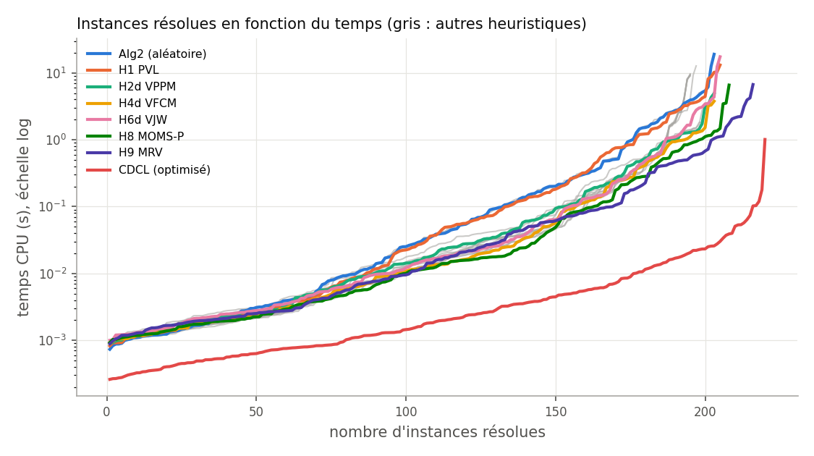
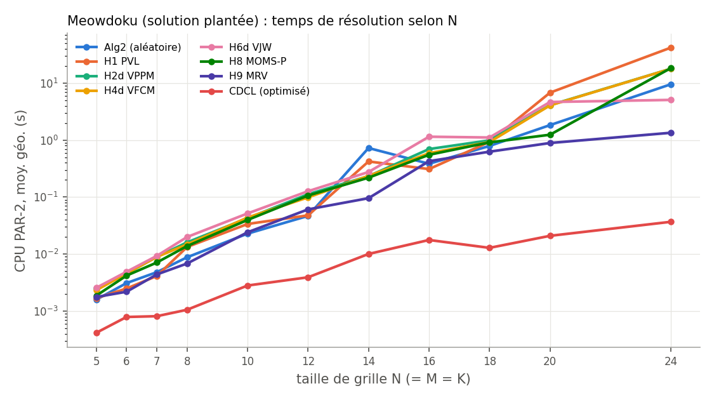
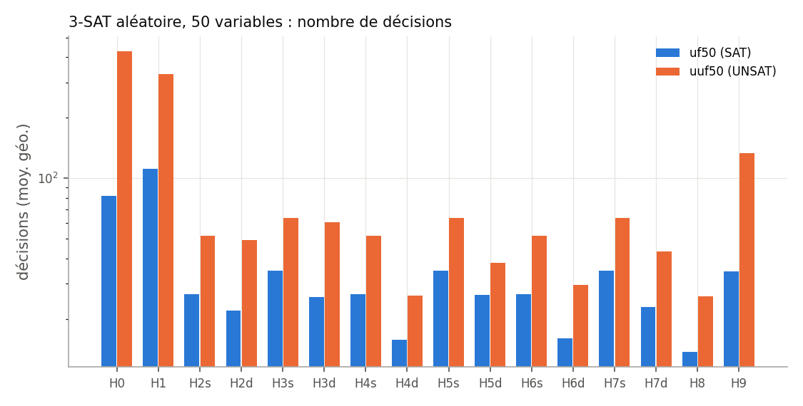

# Introduction

Ce rapport décrit, question par question, les décisions de conception, les
résultats obtenus et leur analyse. Tout le code est en Python (≥ 3.12) ; le
solveur livré (`sat.py`) n'utilise que la bibliothèque standard. Le fichier
`README.md` décrit l'arborescence et la façon de reproduire chaque résultat.

**Jeux de données.** Les enseignants n'ayant pas encore diffusé de fichiers
DIMACS au moment de la rédaction, la validation s'appuie sur :

* des familles classiques de la bibliothèque **SATLIB** (Hoos & Stützle) :
  3-SAT aléatoire au seuil (`uf20`, `uf50`, `uuf50`, `uf75`, `uuf75`, `uf100`,
  `uuf100`), `aim`, `dubois`, `pigeon-hole`, `flat50` (coloration de graphes) ;
  le statut SAT/UNSAT y est connu par construction ;
* des instances que nous générons (`gen_cnf.py`) : 3-SAT aléatoire à trois
  ratios clauses/variables, principe des tiroirs PHP(n+1, n), et surtout des
  grilles Meowdoku (à solution plantée ou à régions aléatoires). Leur statut
  attendu est calculé par un solveur de référence indépendant (`pycosat`,
  liaison Python de PicoSAT), uniquement pour la validation.

**Usage des assistants IA.** Des assistants IA ont été utilisés tout au
long du projet de trois façons : comme interlocuteur pour discuter et
comparer des idées (choix d'encodage, heuristiques, conception du solveur),
comme aide pour comprendre des notions et des algorithmes, et comme soutien
lors de l'écriture du code.

---

# Question 1 — Modélisation du Meowdoku

## Variables

Pour une grille N × M, on introduit une variable $x_{i,j}$ par case,
vraie ssi un chat occupe la case $(i,j)$. Numérotation DIMACS :
$\mathrm{var}(i,j) = (i-1)\,M + j \in \{1,\dots,NM\}$ (ordre ligne par ligne).
Le décodage d'une valuation témoin $v$ est immédiat : les chats sont sur les
cases $\{(i,j) \mid v(x_{i,j}) = 1\}$.

## Clauses

Notons $R_1,\dots,R_K$ les régions.

| Famille | Contrainte | Clauses | Nombre |
|---|---|---|---|
| R≥1 | au moins un chat par région | $\bigvee_{c\in R_k} x_c$ | $K$ |
| R≤1 | au plus un chat par région | $\neg x_c \vee \neg x_{c'}$, $c \neq c' \in R_k$ | $\sum_k \binom{\lvert R_k\rvert}{2}$ |
| L≤1 | au plus un chat par ligne | $\neg x_{i,j} \vee \neg x_{i,j'}$, $j<j'$ | $N\binom{M}{2}$ |
| C≤1 | au plus un chat par colonne | $\neg x_{i,j} \vee \neg x_{i',j}$, $i<i'$ | $M\binom{N}{2}$ |
| ADJ | pas de chats voisins en diagonale | $\neg x_{i,j} \vee \neg x_{i+1,j\pm1}$ | $2(N-1)(M-1)$ |
| L≥1 *(redondante)* | si $K=N$ : un chat par ligne | $\bigvee_j x_{i,j}$ | $N$ |
| C≥1 *(redondante)* | si $K=M$ : un chat par colonne | $\bigvee_i x_{i,j}$ | $M$ |

**Choix de conception.**

* *Adjacence.* Le 8-voisinage comprend des voisins horizontaux, verticaux et
  diagonaux. Les deux premiers sont déjà interdits par L≤1 et C≤1 : seules les
  diagonales demandent des clauses spécifiques (deux par case, vers la ligne
  suivante, ce qui couvre chaque paire une seule fois).
* *Codage « par paires » des contraintes « au plus un ».* Il n'utilise que les
  variables $x_{i,j}$, comme demandé, et ne produit que des clauses binaires,
  idéales pour la propagation unitaire : poser un chat élimine immédiatement
  toutes les cases de sa ligne, de sa colonne, de sa région et ses voisines
  diagonales. Son défaut est un nombre quadratique de clauses ($O(N^3)$ pour
  N = M = K, davantage si une région est très grande). Nous avons aussi
  implémenté (option `--amo seq`) le **compteur séquentiel** de Sinz (2005),
  linéaire mais introduisant des variables auxiliaires ; avec le codage par
  paires, une grille 50 × 50 donne déjà ≈ 190 000 clauses, résolues en moins
  d'une seconde par le solveur optimisé : le codage par paires reste le
  choix par défaut.
* *Dédoublonnage.* Deux cases d'une même région **et** d'une même ligne
  engendreraient deux fois la même clause : l'encodeur ne l'émet qu'une fois
  (sur la grille de la figure 1 : 321 clauses au lieu de 420).
* *Clauses redondantes L≥1 / C≥1.* Lorsque $K = N$, il y a K chats, au plus un
  par ligne, sur N = K lignes : chaque ligne en contient exactement un (principe
  des tiroirs). Ces clauses ne changent donc pas l'ensemble des modèles mais
  rendent accessible à la simple propagation unitaire une déduction qui
  demanderait sinon un raisonnement par l'absurde coûteux (« la seule case
  encore possible de la ligne doit porter un chat »). Leur effet est mesuré en Q5.
* *Cas général.* L'encodage traite N, M, K quelconques ; si $K > \min(N,M)$ la
  formule est (correctement) insatisfiable.

**Correction.** Une valuation satisfait R≥1 ∧ R≤1 ssi chaque région contient
exactement un chat ; L≤1, C≤1 expriment directement les règles 1 et 2 ;
L≤1 ∧ C≤1 ∧ ADJ interdisent toute paire de chats 8-voisins. Les modèles de la
formule (restreints aux $x_{i,j}$) sont donc exactement les solutions de la grille.

**Fichiers.** `meowdoku/grid.py` lit/écrit le format de la figure 1b (lignes
`c` ignorées — sauf cas limite d'une région nommée `c`, géré —, `GRID`,
`ZONES`, contrôles : dimensions, régions déclarées, régions non vides).
`meow2cnf.py grille.txt -o grille.cnf` produit le DIMACS, avec en commentaire
la table des variables et le décompte des clauses par famille.

## Générateur de grilles

`generate_grids.py N [--M M --K K] [--count c] [--unique] [--random]`
(`meowdoku/generate.py`). Méthode **par solution plantée** :

1. *Placement des K chats* : recherche aléatoire avec retour arrière (lignes
   distinctes tirées au hasard, colonnes mélangées) d'un ensemble de K cases sur
   des lignes et colonnes distinctes et non adjacentes. Pour N = M = K, c'est
   une permutation σ avec $\lvert\sigma(i)-\sigma(i+1)\rvert \ge 2$ (il en
   existe pour N = 1 et N ≥ 4 ; N = 2, 3 sont impossibles).
2. *Croissance des régions* : chaque chat est le germe d'une région ; on tire
   au hasard une case de la frontière commune et on l'attribue à la région qui
   l'a proposée, jusqu'à couvrir la grille. Les régions sont connexes, forment
   une partition et chacune contient exactement son chat : **le placement de
   l'étape 1 est une solution par construction.** Les noms de régions sont
   affectés après mélange, pour qu'ils ne trahissent pas la position du chat.
3. *Unicité (option `--unique`)* : une vraie grille de jeu a une solution
   unique. On cherche avec notre solveur une solution S′ ≠ S (en bloquant S par
   la clause $\bigvee_{c\in S}\neg x_c$). Si elle existe, on choisit une case
   c ∈ S′ \ S et on la cède à une région voisine, à condition que sa région
   d'origine reste connexe. S′ devient illicite (sa région d'origine n'a plus
   de chat, la région d'accueil en a deux) alors que S reste licite (c n'est
   pas un germe). On itère jusqu'à unicité. En pratique : quelques secondes
   jusqu'à 12 × 12 ; au-delà, le nombre de solutions
   concurrentes rend la méthode lente (limite assumée de l'option).

L'option `--random` tire au contraire des germes quelconques : la grille n'a
alors **aucune garantie de solution** ; elle sert à produire des instances
UNSAT réalistes pour la question 5 (≈ 60 % le sont).

---

# Question 2 — Lecture DIMACS et algorithmes 1 et 2

## Structure de données (`solver/cnf.py`)

Un littéral est un entier non nul (convention DIMACS : `k` pour $x_k$, `-k`
pour $\neg x_k$) : négation et variable sont en O(1) (`-l`, `abs(l)`). Une
formule est un objet `CNF(num_vars, clauses)`. Le lecteur tolère les
particularités des fichiers réels (clause répartie sur plusieurs lignes, ligne
`%` de fin des fichiers SATLIB, espaces multiples) et vérifie la présence de
l'en-tête ; un mode `strict` contrôle la cohérence avec l'en-tête. Certains
fichiers omettent le `0` final de nombreuses lignes (c'est le cas de
`dubois100.cnf` de SATLIB) : lire « jusqu'au 0 » fusionne alors des clauses
(598 au lieu de 800) et rend la formule satisfiable. Lorsque le nombre de
clauses lues ne correspond pas à l'en-tête mais que la lecture « une ligne =
une clause » (règle de l'énoncé) y correspond, c'est cette dernière qui est
retenue. Ce cas a été détecté par la simulation de compétition (Q6).

Pour DPLL, chaque clause devient un `frozenset` : appartenance en O(1),
élimination des doublons, et surtout possibilité de **partager** entre père et
fils les clauses non modifiées par une affectation. Les clauses tautologiques
($p \vee \neg p$) sont retirées à la lecture (toujours vraies, elles
fausseraient la règle du littéral pur).

## Algorithmes (`solver/dpll.py`)

Implémentation fidèle au pseudo-code : récursive, sans effet de bord.

* `assign(F, l)` calcule $F[l \leftarrow 1]$ : on supprime les clauses
  contenant $l$ et on retire $\neg l$ des autres ; $F[p \leftarrow 0]$ s'écrit
  `assign(F, -p)`.
* Une **seule passe** (`scan`) sur F traite les lignes 1 à 11 : détection de la
  clause vide, d'une clause unitaire, et calcul de l'ensemble des littéraux
  (un littéral $l$ est pur ssi $\neg l$ n'y figure pas).
* `dpll1` renvoie SAT/UNSAT ; `dpll2` renvoie en plus une valuation (un
  `dict`, enrichi en remontant la récursion : « $v \cup \{l\}$ »). Les
  variables disparues de la formule sans avoir été affectées peuvent prendre
  n'importe quelle valeur : on les complète à `False`.
* `RandomChoice` : variable uniforme parmi celles de F, valeur uniforme ; le
  générateur pseudo-aléatoire est **graine-able** (reproductibilité).
* La profondeur de récursion peut atteindre le nombre de variables : l'appel
  est exécuté dans un fil d'exécution à grosse pile avec une limite de
  récursion relevée (`run_deep`).

**Complexité.** Chaque nœud coûte $O(\lvert F\rvert)$ (une passe d'analyse +
la construction de $F[l\leftarrow b]$), et la mémoire est en
$O(\text{profondeur} \times \lvert F\rvert)$ dans le pire cas (en pratique bien
moins grâce au partage des clauses intactes). Le nombre de nœuds est
exponentiel dans le pire cas ($2^n$).

## Validation (`validate.py`)

139 instances (SATLIB + générées, 85 SAT / 52 UNSAT + 2 sans statut de
référence), 19 solveurs (algorithmes 1 et 2, DPLL_H avec chacune des 16
configurations d'heuristiques, CDCL), limite de 20 s : **2 641 exécutions, aucune réponse
fausse, tous les modèles renvoyés vérifiés** (chaque clause contient un
littéral vrai) et aucune contradiction de statut entre solveurs. Les
exécutions non terminées concernent `aim-100/200`, `dubois`, `hole10`.
Les tests unitaires (`tests/`, 59 tests) comparent en outre tous les solveurs
à une énumération exhaustive sur 40 petites formules aléatoires (dont formules
vides, clause vide, clauses unitaires, tautologies) et vérifient les exemples
de l'énoncé.

## Performances

Les mesures détaillées sont en Q5. En résumé pour l'algorithme 2 (choix
aléatoire) : quelques millisecondes pour `uf20`, ~30 ms pour `uf50`, ~0,2 s
pour `uuf50`, plusieurs secondes pour `uuf75`, et échec (> 20 s) sur
`dubois20` (60 variables seulement !). La croissance est clairement
exponentielle en n, et **les instances UNSAT sont nettement plus coûteuses**
que les SAT de même taille : il faut parcourir tout l'arbre, alors qu'une
instance SAT s'arrête à la première feuille satisfaisante. Le coût par nœud
est dominé par la recopie de la formule. L'algorithme 1 a le même arbre de
recherche que l'algorithme 2 (même graine) ; il économise seulement la
construction de la valuation, négligeable.

---

# Question 3 — Résolution d'une grille

`solve_meowdoku.py grille.txt -o solution.txt` enchaîne :
grille → CNF → **écriture d'un fichier DIMACS** → relecture de ce fichier et
résolution par notre solveur (CDCL par défaut ; `--solver dpll` ou
`--solver dpllh --heuristic H9` possibles) → décodage → **vérification
indépendante** des quatre règles (`check_solution`, qui ne réutilise pas
l'encodage CNF) → fichier solution au format de la figure 2 (recopie de
l'entrée, dictionnaire région ↦ (ligne, colonne), grille de `*`).

Sur la grille de la figure 1, la sortie est identique à la figure 2 ; le
générateur confirme que cette solution est unique. `verify_solution.py`
vérifie un fichier solution existant (cohérence dictionnaire/grille de `*` et
règles du jeu). Si la grille est illicite (formule UNSAT), le programme le
signale et renvoie un code d'erreur.

---

# Question 4 — Heuristiques de branchement

## Implémentation (`solver/heuristics.py`, `solver/dpll_h.py`)

`DPLLH` reprend exactement l'algorithme 2, `RandomChoice` étant remplacé par
`heuristic.choose(F, lits)`. Une heuristique expose `prepare(F₀)` (appelée
une fois sur la formule initiale) et `choose(F, lits)` (à chaque décision).

* « Variable non encore affectée » = variable présente dans la formule
  courante (une variable absente est affectée ou sans influence :
  $F[p\leftarrow b] = F$, la choisir serait une décision inutile).
* **Versions statiques** : `prepare` calcule une fois pour toutes un ordre de
  couples (variable, valeur) sur F₀ ; une décision prend le premier couple dont
  la variable est encore présente.
* **Versions dynamiques** : les compteurs sont recalculés sur la formule
  courante à chaque décision. Le comptage utilise `collections.Counter.update`
  (boucle en C) ; les poids de Jeroslow-Wang sont calculés en regroupant les
  clauses par taille (un `Counter` par taille puis une combinaison pondérée),
  ce qui évite une boucle Python par littéral.
* Départage des ex æquo : plus petit indice (toutes les heuristiques non
  aléatoires sont déterministes, donc les mesures reproductibles).

Nous avons implémenté **toutes** les heuristiques de l'énoncé, dans leurs deux
variantes : H0 (CA), H1 (PVL), H2–H7 en `s` et `d` (VPPM, LP, VFCM/MOMS,
LFCM, VJW, LJW), soit 14 configurations, auxquelles s'ajoutent deux
heuristiques personnelles. Les contraintes de l'énoncé sont donc couvertes
(sélection de littéral : H3, H5, H7 ; taille des clauses : H4–H7 ; dynamiques :
H2d–H7d).

**Adaptations (signalées).** (1) Pour H4s/H5s, la taille minimale k est
calculée sur les clauses *non unitaires* de F₀ : les clauses unitaires
initiales sont propagées avant toute décision, et k = 1 rendrait l'ordre
statique dénué de sens. (2) Pour H4s/H5s, de nombreuses variables ont
$\#_k = 0$ : on départage alors par $\#(p, F_0)$ plutôt que par indice.
(3) Dans l'énoncé de H5, « 1 si l est de la forme ¬p » est une coquille : nous
affectons 0 dans ce cas (ce que confirme la phrase suivante de l'énoncé).

**Conformité.** Les heuristiques sont validées comme l'algorithme 2 (Q2) :
mêmes statuts, modèles vérifiés, et test unitaire reproduisant l'exemple de
l'énoncé ($\sum_k \#_k(x_2,F)\,2^{-k} = 7/16$, H6 choisit $x_2 \leftarrow 1$).

## Heuristiques personnelles

* **H8 — MOMS-produit** (inspirée de POSIT, Freeman 1995). Sur les clauses de
  taille minimale : $\mathrm{score}(p) = \mathrm{occ}_k(p)\,\mathrm{occ}_k(\neg
  p)\,2^{10} + \mathrm{occ}_k(p) + \mathrm{occ}_k(\neg p)$. Le produit favorise
  les variables présentes avec **les deux** polarités : chacune des deux branches
  raccourcit alors beaucoup de clauses minimales, donc produit des propagations
  unitaires des deux côtés — c'est précisément ce qui réduit l'arbre lorsqu'il
  faut explorer les deux branches (instances UNSAT).
* **H9 — MRV, « plus petite clause positive ».** Conçue après les premières
  mesures de Q5 (voir ci-dessous) : on choisit la plus petite clause dont tous
  les littéraux sont positifs, et on y affecte à 1 la variable la moins
  contraignante (celle dont le littéral négatif apparaît le moins dans les
  clauses binaires). Sur le Meowdoku, les clauses positives sont exactement
  les contraintes « au moins un chat » (région, ligne, colonne) : on traite
  d'abord la région/ligne/colonne ayant le moins de cases possibles (heuristique
  *Minimum Remaining Values* des solveurs de contraintes) et on y pose un chat.
  Repli sur H6d s'il n'existe aucune clause entièrement positive. Le choix de la
  case « la moins contraignante » a été retenu après des essais préliminaires
  sur les grandes grilles (limite de 30 s ; PAR-2 de 15 s, contre 30 s pour « plus petit indice » et 71 s pour
  « la plus contraignante »).

**Pourquoi ces choix.** Les heuristiques de l'énoncé couvrent deux axes
indépendants (variable vs littéral ; fréquence brute vs clauses courtes vs
pondération JW) croisés avec statique/dynamique : les implémenter toutes coûte
peu (une trentaine de lignes chacune, grâce à des fonctions de comptage
partagées) et permet en Q5 une comparaison *toutes choses égales par
ailleurs*. Les deux heuristiques personnelles testent deux idées : favoriser
les propagations dans les deux branches (H8, ciblant l'UNSAT) et exploiter la
structure « exactement un » du Meowdoku (H9).

---

# Question 5 — Instrumentation et analyse des performances

## Protocole

* **Instrumentation** (`solver/dpll_h.py`, classe `Stats`) : les compteurs
  demandés sont incrémentés aux lignes correspondantes de l'algorithme 3 —
  décisions (ligne 17), retours arrière (branche `else`, ligne 21),
  propagations unitaires (ligne 5), littéraux purs (ligne 11) — ainsi que
  nombre de nœuds, de conflits (clause vide), profondeur maximale, temps
  total et temps passé dans l'heuristique (`prepare` + `choose`), d'où le
  **ratio de temps consacré à l'heuristique**.
* **Instances** (`benchmark.py`) : 220 instances en 3 catégories —
  *3-SAT aléatoire* (`uf20`, `uf50`, `uuf50`, `uf75`, `uuf75` et nos `rand3` à
  trois ratios clauses/variables), *structurées* (`aim-50`, `dubois20–23`, PHP,
  `flat50`) et *Meowdoku* (`meow_sat` : grilles plantées N = 5..24 ;
  `meow_nored` : les mêmes sans clauses redondantes ; `meow_rnd` : grilles à
  régions aléatoires, SAT ou UNSAT). 145 instances SAT, 75 UNSAT.
* **Solveurs** : algorithme 2, les 16 configurations de DPLL_H et le solveur
  optimisé (CDCL, Q6) comme référence. Les solveurs aléatoires (Alg2, H0)
  sont lancés avec 3 graines : **4 840 exécutions**.
* **Mesure** : chaque exécution a lieu dans un processus fils, limite de
  20 s. Le score **PAR-2** compte une exécution non terminée pour 2 × la
  limite. Les moyennes sont **géométriques** (les temps s'étalent sur
  5 ordres de grandeur). Machine : Windows 11, Python 3.12, 6 processus en
  parallèle (un par cœur physique). Sous Windows, `time.process_time` n'avance
  que par pas de 15,6 ms (un tiers des exécutions mesuraient 0 s lors d'un
  premier essai) ; nous utilisons donc `time.perf_counter`, ce qui est
  légitime puisque chaque mesure s'exécute seule dans un processus sans
  entrées/sorties. Les compteurs, eux, sont exacts et indépendants de la machine.
* **Correction** : 0 réponse fausse sur les 4 840 exécutions, tous les
  modèles vérifiés.

Tableaux complets : `results/tables.md` ; figures : `results/fig_*.png`.
Reproduction : `python benchmark.py --timeout 20 --jobs 6 && python analyze.py`.

## Vue d'ensemble

| solveur | résolues | SAT | UNSAT | PAR-2 moyen | heur. % |
|---|---|---|---|---|---|
| Alg2 / H0 (aléatoire) | 91,5 % | 94,5 % | 85,8 % | 4,12 s | 2 |
| H1 PVL | 93,2 % | 94,5 % | 90,7 % | 3,44 s | 2 |
| H2s–H7s (statiques) | 88,6–89,5 % | 90–92 % | 85,3 % | 4,6–5,0 s | 7–13 |
| H2d–H7d (dynamiques) | 92,3–93,2 % | 96–97 % | 85,3 % | 3,2–3,5 s | 34–45 |
| H8 MOMS-produit | 94,5 % | 97,2 % | 89,3 % | 2,47 s | 31 |
| **H9 MRV** | **98,2 %** | **100 %** | **94,7 %** | **0,99 s** | 13 |
| CDCL (Q6) | 100 % | 100 % | 100 % | 0,013 s | — |



Le classement global masque des comportements très différents selon la
famille ; nous les analysons séparément ci-dessous (compteurs : moyennes
géométriques sur les 190 instances résolues par tous les solveurs DPLL).

## L'heuristique améliore-t-elle l'algorithme 2 ?

**Sur le 3-SAT aléatoire et les instances structurées : oui, nettement.**

| décisions (moy. géo.) | 3-SAT SAT | 3-SAT UNSAT | structuré SAT | structuré UNSAT |
|---|---|---|---|---|
| H0 (aléatoire) | 32 | 173 | 559 | 4 150 |
| H1 PVL | 26 | 159 | 326 | 3 100 |
| H2s VPPM | 12 | 37 | 59 | 1 770 |
| H4d VFCM | 9,3 | 18 | 37 | 726 |
| H6d VJW | 8,7 | 21 | 23 | 449 |
| H8 MOMS-P | 8,8 | **16** | 23 | 877 |
| H9 MRV | 20 | 64 | **15** | **182** |

Toute heuristique fondée sur les occurrences divise le nombre de décisions
par 5 à 10 sur le 3-SAT UNSAT, et le temps en proportion : sur `uuf75`
(75 variables, UNSAT), le PAR-2 passe de 4,0 s (Alg2) à 0,09 s (H8) ou
0,12 s (H4d), soit un facteur 40 ; sur `aim`, de 1,3 s à 0,04 s (H6d). H1
(première variable libre) n'apporte presque rien : l'ordre DIMACS n'a aucun
sens sur une instance aléatoire. **La famille `dubois` reste hors de portée de
tous les DPLL** (60 à 69 variables seulement !) alors que CDCL la résout en
5 ms : ces formules (chaînes de XOR) imposent à DPLL de ré-explorer des
sous-arbres d'échec identiques, ce qu'aucun ordre de branchement n'évite —
c'est l'argument principal du solveur optimisé de la Q6.

**Sur le Meowdoku : non, sauf pour H8 et H9.** Les heuristiques de l'énoncé
font *moins bien* que le hasard sur les grilles (grilles plantées N ≥ 16 :
78 % résolues pour Alg2, 50 % pour les statiques, 75 % pour la plupart des
dynamiques ; régions aléatoires : 74 % pour Alg2, 73–77 % pour H2–H7).

| Meowdoku | décisions SAT | retours arr. SAT | décisions UNSAT |
|---|---|---|---|
| H0 (aléatoire) | 20 | 6,4 | 8,9 |
| H2s–H7s | 52 | 7,5 | 19 |
| H2d–H7d | 56–70 | 0,7–1,4 | 17–21 |
| H8 MOMS-P | 42 | 1,0 | 2,3 |
| H9 MRV | **8,1** | 1,2 | **1,4** |

Explication : une variable $x_{i,j}$ apparaît **positivement** dans au plus
3 clauses (région, ligne, colonne) mais **négativement** dans O(N) clauses
binaires « au plus un » et d'adjacence. Toutes les heuristiques à polarité
majoritaire choisissent donc $x_{i,j} = 0$ (« pas de chat ici ») : une
décision qui ne propage presque rien. Il faut alors 50 à 70 décisions là où
le hasard, qui pose un chat une fois sur deux, en fait 20. Une décision
$x_{i,j} = 1$ élimine au contraire d'un coup ligne, colonne, région et
voisinage, par propagation unitaire. C'est cette observation qui a conduit à
**H9** (Q4) : brancher sur la plus petite clause positive (la région, la
ligne ou la colonne ayant le moins de cases encore possibles) avec la valeur 1.
H9 résout **100 %** des grilles, y compris en 24 × 24, avec 2,5 fois moins
de décisions que le hasard. H8, dont le score produit
$\mathrm{occ}_k(p)\cdot\mathrm{occ}_k(\neg p)$ favorise les variables
présentes dans les deux polarités parmi les clauses minimales, est
également très efficace sur les grilles UNSAT (2,3 décisions).



La croissance est exponentielle en N pour tous les DPLL (pente quasi
constante en échelle log) ; H9 garde une pente plus faible (1,3 s en
24 × 24 contre 5 à 40 s, avec des échecs, pour les autres), CDCL reste
sous 0,05 s.

## Statique ou dynamique ?

| heuristique | décisions d/s | CPU d/s | heur. % s | heur. % d | résolues s / d |
|---|---|---|---|---|---|
| H2 VPPM | 0,96 | 1,33 | 7 | 37 | 195 / 203 |
| H3 LP | 0,99 | 1,36 | 8 | 38 | 195 / 203 |
| H4 VFCM | **0,75** | **0,99** | 13 | 32 | 195 / 203 |
| H5 LFCM | 0,87 | 1,06 | 12 | 33 | 195 / 203 |
| H6 VJW | **0,75** | 1,16 | 8 | 41 | 197 / 205 |
| H7 LJW | 0,85 | 1,21 | 9 | 43 | 195 / 203 |

(rapports géométriques dynamique / statique sur les instances résolues par les deux)

* Le recalcul **réduit l'arbre**, mais surtout pour les heuristiques qui
  dépendent de la **taille des clauses** (H4, H6 : −25 % de décisions). La
  fréquence brute d'une variable (H2, H3) évolue peu au cours de la
  recherche ; la taille des clauses, si : au départ toutes les clauses d'un
  3-SAT ont la taille 3, de sorte que H4s et H6s produisent **exactement le
  même ordre** que H2s (compteurs identiques dans les tableaux), alors que
  H4d/H6d exploitent les clauses binaires créées par la recherche.
* Ce gain est **absorbé par le coût** : un recalcul en O(|F|) à chaque
  décision fait passer la part de l'heuristique de 7–13 % à 32–43 % du temps.
  Au total, le dynamique n'est rentable en temps que pour H4 (rapport 0,99),
  et coûte 6 à 36 % de plus pour les autres sur les instances faciles.
* En revanche le dynamique **résout plus d'instances** (203–205 contre
  195–197) : la réduction de l'arbre est multiplicative (elle croît avec la
  taille de l'instance) alors que le surcoût est un facteur constant par
  nœud. Sur les instances difficiles, c'est le dynamique qui l'emporte (PAR-2
  3,2–3,5 s contre 4,6–5,0 s).

## Variable ou littéral ?

À critère égal, les heuristiques *variable + polarité majoritaire* (H2, H4,
H6) battent leur version *littéral* (H3, H5, H7), surtout en UNSAT : 3-SAT
UNSAT, 37 contre 48 décisions (statiques), 18 contre 26 (H4d / H5d), 21
contre 30 (H6d / H7d). Sur une instance UNSAT les deux branches sont
explorées : ce qui compte est la réduction obtenue dans *les deux* branches,
que mesure le nombre total d'occurrences $\#(p, F)$, et non celle d'une seule
polarité.

## SAT et UNSAT

* Les instances UNSAT demandent 5 à 10 fois plus de décisions que les SAT de
  même taille (3-SAT : 173 contre 32 pour H0) : il faut épuiser l'arbre,
  alors qu'une instance SAT s'arrête à la première feuille satisfaisante.
  Une bonne heuristique gagne donc davantage sur l'UNSAT (où elle doit
  provoquer des conflits tôt) que sur le SAT (où elle doit deviner la bonne
  polarité).
* Sur les instances UNSAT, retours arrière = décisions dans tous les
  tableaux : chaque décision échoue dans ses deux branches. C'est un contrôle
  de cohérence de l'instrumentation.
* `fig_decisions_uf50.png` illustre l'écart SAT / UNSAT pour chaque
  heuristique sur les instances à 50 variables.



## Autres observations

* **Littéraux purs.** Fréquents sur le 3-SAT et les instances structurées,
  **jamais** appliqués sur le Meowdoku : une variable ne perd ses occurrences
  positives que si sa clause « au moins un » est satisfaite, c'est-à-dire si
  un chat est posé dans sa région, et la propagation des clauses « au plus
  un » l'a alors déjà mise à 0. Son coût (calcul de l'ensemble des
  littéraux) y est donc pure perte.
* **Clauses redondantes L≥1 / C≥1 (Q1).** Sans elles, CDCL fait 3,8 fois plus
  de décisions (temps × 1,8), les heuristiques statiques 1,5 fois plus ; les
  dynamiques et H9, qui trouvent seules les « dernières cases libres », y
  sont presque insensibles (1,0–1,2).
* **Ratio heuristique.** Sur le Meowdoku SAT, les heuristiques dynamiques
  passent 62–67 % du temps à calculer leur score : les grilles ont beaucoup
  de clauses (O(N³)) et peu de décisions utiles, ce qui renforce l'intérêt
  d'une heuristique bon marché et adaptée (H9 : 16 %).

## Bilan : attentes et observations

* *Conforme aux attentes* : les heuristiques à base d'occurrences écrasent
  le hasard sur le 3-SAT (facteur 5 à 40) ; les heuristiques de type MOMS /
  Jeroslow-Wang sont les meilleures sur le 3-SAT UNSAT (H8, H4d, H6d) ; l'UNSAT
  est beaucoup plus coûteux que le SAT.
* *Moins que prévu* : le recalcul dynamique, attendu comme nettement
  supérieur, ne réduit l'arbre que de 0 à 25 % et coûte presque autant qu'il
  rapporte ; son intérêt n'apparaît que sur les instances difficiles.
* *Contraire à nos attentes* : sur le Meowdoku, toutes les heuristiques de
  l'énoncé font moins bien que le hasard, à cause de la polarité majoritaire.
  L'analyse des compteurs (beaucoup de décisions, peu de propagations) a
  directement guidé la conception de H9, la meilleure configuration DPLL.
* *Limite commune* : aucun ordre de branchement ne sauve DPLL sur `dubois` ;
  il faut mémoriser les conflits, d'où le choix d'un CDCL en Q6.

---

# Question 6 — Solveur optimisé et interface imposée

## Interface (`sat.py`)

```
python sat.py instance.cnf [--mode dpll|optimized] [--output-model]
```

* `--mode dpll` : algorithme 2 (Q2), choix aléatoire avec graine fixe
  (`--seed`, 0 par défaut) ;
* `--mode optimized` (défaut) : solveur CDCL ci-dessous ;
* sortie standard réservée au résultat : `s SATISFIABLE` / `s UNSATISFIABLE`
  et, avec `--output-model` et si SAT, `v l1 l2 … 0` (toutes les variables de
  l'en-tête, positives = vraies) ; diagnostics éventuels sur stderr
  (`--verify` vérifie le modèle et l'annonce sur stderr) ;
* code de retour 0 (nous évitons la convention 10/20 des solveurs SAT, qu'une
  infrastructure pourrait interpréter comme une erreur) ;
* aucune dépendance hors bibliothèque standard ; vérifié dans l'image Docker
  `python:3.12-slim` (Python 3.12.15) de la compétition.

## Choix du solveur optimisé (`solver/cdcl.py`)

Conclusions de Q5 qui guident ces choix : (i) le coût par nœud de DPLL est
dominé par la **recopie de la formule** ; (ii) même avec la meilleure
heuristique, DPLL **ré-explore des sous-arbres d'échec identiques** (familles
`dubois`, grilles aléatoires UNSAT) ; (iii) une bonne heuristique dynamique
améliore l'arbre mais son coût de calcul, en $O(\lvert F\rvert)$ par décision,
absorbe une grande part du gain. Le solveur optimisé garde le schéma DPLL
(propagation, décision, retour arrière) mais remplace chaque composant :

| Composant | DPLL (Q2/Q4) | Solveur optimisé |
|---|---|---|
| Formule | recopiée à chaque nœud | modifiée en place, affectations dans un tableau, pile d'affectations (*trail*) et niveaux de décision ; retour arrière = dépiler |
| Propagation unitaire | recherche d'une clause unitaire par parcours complet | **2 littéraux surveillés** : seules les clauses surveillant un littéral devenu faux sont visitées ; liste dédiée pour les **clauses binaires** (majoritaires dans le Meowdoku) |
| Littéral pur | appliqué | abandonné (coûteux à maintenir, peu utile avec l'apprentissage) |
| Conflit | retour chronologique | **analyse 1-UIP**, clause apprise minimisée, **retour non chronologique** |
| Heuristique | statique ou dynamique en $O(\lvert F\rvert)$ | **VSIDS** : activité des variables augmentée lors des conflits et décroissance exponentielle — version dynamique à coût quasi nul de « variable la plus fréquente dans les conflits récents » ; tas binaire (`heapq`) à suppression paresseuse |
| Polarité | selon l'heuristique | **sauvegarde de phase**, polarité initiale **négative** (dans le Meowdoku presque toutes les $x_{i,j}$ sont fausses ; cf. l'observation de Q5 sur la polarité) |
| Divers | — | **redémarrages** (suite de Luby × 100 conflits), **nettoyage** des clauses apprises (critère LBD de Glucose, on conserve les clauses de LBD ≤ 2 et les clauses raisons) |

Littéraux codés `2v` / `2v+1` (négation = `l ^ 1`) pour indexer directement des
listes Python, boucles internes avec variables locales : en Python, le coût
d'un attribut ou d'un appel de fonction domine.

## Résultats (simulation de la compétition)

`competition.py` reproduit la procédure officielle : `python sat.py
instance.cnf --output-model` en sous-processus, limite de 60 s, contrôle du
format exact de la sortie, du statut et du modèle (vérifié indépendamment
contre toutes les clauses). Sur nos **859 instances** (`data/cnf` : SATLIB,
3-SAT généré, PHP, grilles Meowdoku), avec Python 3.12 sous Windows 11
(`results/competition.txt`, `results/competition_*.csv`) :

| mode | résolues | délais dépassés | réponses fausses | temps total (résolues) | médiane | pire temps |
|---|---|---|---|---|---|---|
| `dpll` (algorithme 2) | 776 | 83 | 0 | 2 008 s | 0,25 s | 59 s |
| `optimized` (CDCL) | **857** | 2 | 0 | **127 s** | 0,13 s | 8,3 s |

* Le mode `dpll` échoue sur `aim-100/200` (40), `uuf100` (19), `dubois` (13),
  quelques grandes grilles Meowdoku (9), `hole10` et un `uf100`.
* Le mode optimisé résout tout sauf `hole9` et `hole10` (principe des
  tiroirs, exponentiel pour toute méthode fondée sur la résolution : hors de
  portée d'un CDCL, même écrit en C, pour `hole10`). Son temps médian (0,13 s)
  est essentiellement le **démarrage de l'interpréteur Python** (≈ 0,13 s pour
  `sat.py` sur une formule de 3 clauses) : 98 % des instances sont résolues
  en moins de 0,2 s, la pire (`hole8`) en 8,3 s.
* Les deux modes renvoient toujours le même statut, conformément à l'énoncé.
* Cette simulation a révélé un défaut de notre lecteur DIMACS (fichier
  `dubois100.cnf` dont des lignes ne se terminent pas par 0, cf. Q2), corrigé
  depuis : une réponse fausse coûte plus cher qu'un délai dépassé, d'où
  l'intérêt de tester sur le plus grand nombre possible de fichiers réels.

---

# Éléments originaux, limites et pistes

* Implémentation de **toutes** les heuristiques demandées (statiques et
  dynamiques) et de deux heuristiques personnelles, dont H9, conçue à partir
  de l'analyse des mesures et très efficace sur le Meowdoku.
* Générateur avec option d'**unicité** de la solution par réparations locales.
* Vérification systématique : tous les modèles produits sont vérifiés, tous
  les solveurs sont comparés entre eux, à `pycosat` et à une énumération
  exhaustive ; la solution d'une grille est vérifiée par un contrôleur
  indépendant de l'encodage.
* Simulation de la compétition (`competition.py`) appelant `sat.py` en
  sous-processus et vérifiant le format exact de la sortie.
* **Limites.** Le solveur reste en Python pur : ~100 fois plus lent qu'un
  solveur C. Les instances intrinsèquement dures pour la résolution (tiroirs
  PHP : `hole9` ≈ quelques minutes) restent hors de portée. L'option
  d'unicité du générateur devient lente au-delà de 12 × 12.
* **Pistes.** Pré-traitement (élimination de variables, subsomption),
  littéraux bloqueurs dans les listes de surveillance, minimisation récursive
  des clauses apprises, redémarrages adaptatifs (Glucose), détection et codage
  spécifique des contraintes de cardinalité.

# Références

* M. Davis, H. Putnam. *A computing procedure for quantification theory*. JACM 7(3), 1960.
* M. Davis, G. Logemann, D. Loveland. *A machine program for theorem-proving*. CACM 5, 1962.
* M. Lagoudakis, M. Littman. *Learning to select branching rules in the DPLL procedure for satisfiability*. ENDM 9, 2001.
* R. Jeroslow, J. Wang. *Solving propositional satisfiability problems*. Annals of Math. and AI 1, 1990.
* J. W. Freeman. *Improvements to propositional satisfiability search algorithms* (POSIT). PhD thesis, 1995.
* J. Marques-Silva, K. Sakallah. *GRASP: a search algorithm for propositional satisfiability*. IEEE ToC, 1999.
* M. Moskewicz et al. *Chaff: engineering an efficient SAT solver*. DAC 2001.
* N. Eén, N. Sörensson. *An extensible SAT-solver* (MiniSat). SAT 2003.
* G. Audemard, L. Simon. *Predicting learnt clauses quality in modern SAT solvers* (Glucose). IJCAI 2009.
* C. Sinz. *Towards an optimal CNF encoding of Boolean cardinality constraints*. CP 2005.
* H. Hoos, T. Stützle. *SATLIB: an online resource for research on SAT*. SAT 2000.
